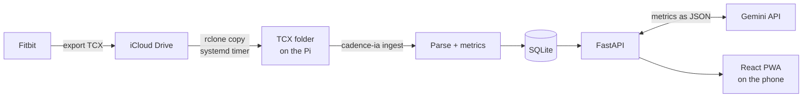

# cadence-ia

A personal training assistant that reads the workouts exported by my **Fitbit** (TCX files),
analyzes the heart-rate curve and tells me how the session went, in the spirit of what Google
does with Gemini, but built by me and running on a Raspberry Pi at home.

It is a mobile-first web app (installable on the iPhone home screen) backed by a small Python API.

## What it does

- **Reads Fitbit TCX exports**: time + heart rate for every sample, plus GPS, altitude and distance
  when the workout has them.
- **Finds sets and rests in strength sessions** from the heart-rate curve alone: HR rises during a
  set and falls during the rest. The detection threshold adapts to each session (5 % of its average
  HR), so it keeps working as fitness improves or for a different person.
- **Measures recovery**: how many bpm the heart rate drops 30 s and 60 s into each rest.
- **Lets you label each workout** with your own types ("Legs", "Upper body", "Walk"…), each one
  either *strength* or *cardio*.
- **Compares each session** with the average of your last 5 sessions of the same type, and charts
  how your average HR and recovery evolve over time.
- **Writes an assessment with an LLM** (Gemini): headline, summary, strengths, things to improve
  and one piece of advice for next time. Only the metrics are sent, never the raw file.

## How it works



1. The watch export lands in an iCloud Drive folder.
2. On the Raspberry Pi, a systemd timer runs `rclone copy` and then `cadence-ia ingest`, which
   parses every TCX not yet in the database, computes its metrics and stores them in SQLite.
3. FastAPI serves the data and the compiled React app on the home network.
4. From the phone you pick the workout type, see the HR curve with the sets shaded, the
   comparison with previous sessions, and ask for the AI assessment.

## Tech stack

| Layer      | Tools |
|------------|-------|
| Backend    | Python 3.11+, FastAPI, Pydantic, SQLite (`sqlite3` from the standard library) |
| Analysis   | Pure Python: TCX parsing with `xml.etree`, resampling, smoothing, zigzag peak detection |
| LLM        | Google Gemini (`google-genai`) with structured JSON output |
| Frontend   | React 19, TypeScript, Vite, React Router, ECharts |
| Deployment | Docker (multi-stage image), Raspberry Pi 4 (Debian 12), systemd timers, rclone (iCloud Drive) |
| Tests      | pytest (backend), oxlint (frontend) |

## Repository layout

```
cadence-ia/
├── apps/
│   ├── backend/
│   │   ├── src/cadence_ia/
│   │   │   ├── tcx.py         # TCX parser
│   │   │   ├── metrics.py     # sets/rests detection and recovery
│   │   │   ├── compare.py     # comparison with previous sessions
│   │   │   ├── db.py          # SQLite schema, migrations and queries
│   │   │   ├── ingest.py      # store new TCX files in the database
│   │   │   ├── assessment.py  # LLM assessment (Gemini)
│   │   │   ├── api.py         # FastAPI app
│   │   │   ├── frontend.py    # serves the built React app
│   │   │   └── cli.py         # `cadence-ia` command
│   │   └── tests/
│   └── frontend/              # React + Vite + TypeScript PWA
├── deploy/
│   ├── sync.sh                # rclone copy + ingest
│   ├── backup.sh              # daily SQLite backup
│   └── systemd/               # timers for both scripts
├── Dockerfile                 # builds the frontend, then the Python image
└── docker-compose.yml
```

## Getting started (development)

Requirements: Python 3.11+, Node.js 20.19+.

### Backend

```bash
cd apps/backend
python -m venv .venv
source .venv/bin/activate          # Windows (Git Bash): source .venv/Scripts/activate
pip install -e ".[dev]"
cp .env.example .env               # then fill in the values (see below)
```

Store your TCX files in the database, then start the API:

```bash
cadence-ia ingest                  # reads CADENCE_DATA_DIR, writes CADENCE_DB
uvicorn cadence_ia.api:app --reload
```

The interactive API docs are at <http://127.0.0.1:8000/docs>.

### Frontend

```bash
cd apps/frontend
npm install
npm run dev
```

Vite proxies `/api` to the backend on port 8000 and listens on the local network, so you can open
`http://<your-pc-ip>:5173` from the phone.

### Configuration

Settings are read from environment variables or from `apps/backend/.env` (never committed; see
`.env.example`):

| Variable           | Default                    | Purpose |
|--------------------|----------------------------|---------|
| `GEMINI_API_KEY`   | –                          | Key for the AI assessment ([get one](https://aistudio.google.com/apikey)) |
| `GEMINI_MODEL`     | `gemini-3.8-flash`         | Gemini model used for the assessment |
| `CADENCE_DATA_DIR` | `~/cadencia-ia/entrada`    | Folder with the `.tcx` files |
| `CADENCE_DB`       | `~/cadencia-ia/cadence.db` | SQLite database file |

For development, point them to the repo, e.g. `CADENCE_DATA_DIR=tests/data` and
`CADENCE_DB=data/cadence.db`.

### Command line

```bash
cadence-ia show path/to/workout.tcx   # print a summary and the sets/rests table
cadence-ia ingest                     # store new TCX files in the database
cadence-ia ingest --force             # re-analyze every file (keeps your workout types)
```

### Tests

```bash
cd apps/backend && pytest             # backend
cd apps/frontend && npm run lint      # frontend
```

The tests build synthetic TCX files, so they run without any personal data. A few extra tests use
a real workout from `tests/data/` and are skipped when it isn't there (TCX files are git-ignored).

## Deployment (Raspberry Pi)

The app runs as one Docker container: a multi-stage build compiles the React app with Node and
copies it into a slim Python image, where FastAPI serves both the API and the web app on port
8000. rclone stays on the host (its iCloud session has to be renewed by hand now and then), and
two systemd timers drive the rest:

| Timer | Runs | What it does |
|-------|------|--------------|
| `cadence-sync.timer` | every 15 min | `rclone copy` from iCloud, then `cadence-ia ingest` in the container |
| `cadence-backup.timer` | daily, 03:30 | consistent SQLite backup, keeping the last 14 |

Data lives on the host, mounted into the container, so rebuilding the image never touches it:

| Host | Container | |
|------|-----------|---|
| `~/cadencia-ia/entrada` | `/data/tcx` (read only) | TCX files downloaded by rclone |
| `~/cadencia-ia/data` | `/data/db` | `cadence.db` and `backups/` |

### First install

Assumes rclone is already configured with an `icloud` remote.

```bash
# Docker and git
curl -fsSL https://get.docker.com | sh
sudo usermod -aG docker $USER      # then log out and back in
sudo apt install -y git

# Code, data folder and secrets
git clone https://github.com/abraham-diaz/cadence-ia.git ~/cadence-ia
cd ~/cadence-ia
mkdir -p ~/cadencia-ia/entrada ~/cadencia-ia/data
cp apps/backend/.env.example apps/backend/.env
nano apps/backend/.env             # set GEMINI_API_KEY
chmod 600 apps/backend/.env

# Build and start (the first build on a Pi 4 takes a few minutes)
docker compose up -d --build

# First sync by hand, then enable the timers
bash deploy/sync.sh
sudo cp deploy/systemd/* /etc/systemd/system/
sudo systemctl daemon-reload
sudo systemctl enable --now cadence-sync.timer cadence-backup.timer
```

Then open `http://<pi-ip>:8000` on the phone and use *Share → Add to Home Screen*.

The container runs as uid 1000 (the first user on Raspberry Pi OS / Debian). If your user has a
different uid, build with `docker compose build --build-arg UID=$(id -u)`.

### Updating

```bash
cd ~/cadence-ia && git pull && docker compose up -d --build
```

### Useful commands

```bash
docker compose logs -f                     # API logs
systemctl list-timers 'cadence-*'          # next runs
journalctl -u cadence-sync -n 50           # last sync / ingest output
rclone config reconnect icloud:            # when the iCloud session expires
```

## API

| Method | Path | Description |
|--------|------|-------------|
| `GET`    | `/api/sessions` | List sessions, newest first |
| `GET`    | `/api/sessions/{id}` | Session detail: HR curve, sets/rests, stats, comparison, history, assessment |
| `PUT`    | `/api/sessions/{id}/workout-type` | Set (or clear) the session's workout type |
| `POST`   | `/api/sessions/{id}/assessment` | Ask the LLM for a new assessment and store it |
| `GET`    | `/api/workout-types` | List workout types |
| `POST`   | `/api/workout-types` | Create a workout type |
| `PUT`    | `/api/workout-types/{id}` | Rename or re-categorize a type |
| `DELETE` | `/api/workout-types/{id}` | Delete a type (its sessions become unlabeled) |
| `GET`    | `/api/health` | Health check |

## Notes and limitations

- **Heart rate is not load.** In strength training the HR curve shows the pattern of effort and
  rest, not the weight lifted. Fitbit's calories are only an estimate.
- **Fitbit tags every workout as `Sport="Other"`**, which is why the workout type is chosen by hand.
- **Privacy:** on Gemini's free tier, Google may use the requests to improve its products. The app
  only sends aggregated metrics (type, duration, HR, sets, recovery): no GPS, device, file names or
  personal data.
- **Database migrations:** the database stores user data (workout types, assessments), so schema
  changes are versioned migrations in `db.py` (`PRAGMA user_version`), never a rebuild.

## Roadmap

- [x] **1. TCX reader** with a CLI to try it out
- [x] **2. Heart-rate metrics**: sets, rests and recovery, with an adaptive threshold
- [x] **3. REST API** with FastAPI
- [x] **4. Mobile-first frontend**: session list and detail with the HR curve
- [x] **5. SQLite history**: ingestion, workout types (CRUD) and comparisons between sessions
- [x] **6. AI assessment** with Gemini, shown in the frontend
- [ ] **7. Deployment on the Raspberry Pi**: Docker image serving API + frontend, rclone + ingest
      timer, daily database backups
- [ ] Alerts when the rclone iCloud session expires (ntfy, Telegram…)
- [ ] Cardio sessions: pace, per-km splits, smoothed elevation and a route map coloured by HR
- [ ] Heart-rate zones once the max HR is known
- [ ] Optional notes per workout (exercises, weights, reps) to cross with the HR curve

## Author

Abraham Díaz · [github.com/abraham-diaz](https://github.com/abraham-diaz)
