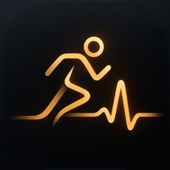
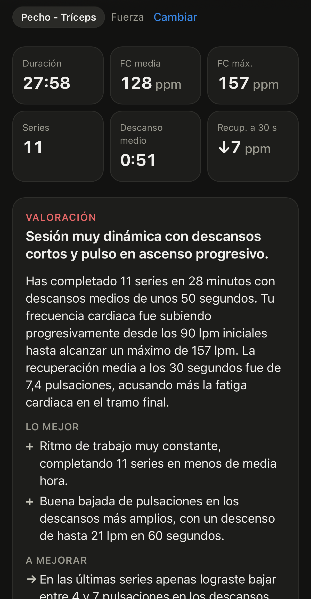
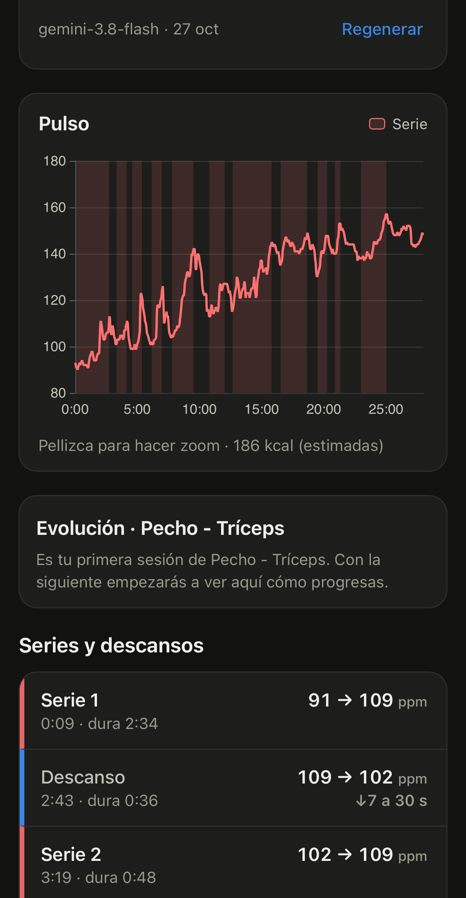
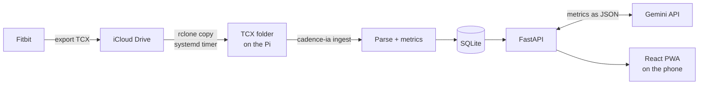

<div align="center">


# Cadence IA

### Self-hosted training assistant that reads your heart rate

         

</div>

---

## What is Cadence IA?

Cadence IA is a personal training assistant. It reads the workouts exported by a **Fitbit** (TCX
files), analyzes the heart-rate curve and tells you how the session went — in the spirit of what
Google does with Gemini, but self-built and running on a Raspberry Pi at home.

It's a mobile-first PWA, installed on the iPhone home screen, backed by a small Python API.

<div align="center">

&nbsp;&nbsp;

</div>

---

## Features

- **TCX import** — time and heart rate for every sample, plus GPS, altitude and distance when present
- **Sets and rests from HR alone** — HR rises during a set and falls during the rest; the threshold adapts to each session (5 % of its average HR)
- **Recovery** — how many bpm the heart rate drops 30 s and 60 s into each rest
- **Workout types** — your own labels ("Legs", "Walk"…), each one *strength* or *cardio*
- **Comparisons** — each session against the average of your last 5 of the same type, with history charts
- **AI assessment** — Gemini writes a headline, summary, strengths, things to improve and one tip; only metrics are sent, never the raw file
- **Training plans** — design a plan by chatting with a Gemini coach, review and edit it, then track the week's progress against it
- **Exercise catalog** — names, pictures and how-to steps from [wger.de](https://wger.de), stored locally
- **PWA** — installable, light/dark theme from the system, swipeable tabs

---

## How it works



1. The watch export lands in an iCloud Drive folder.
2. On the Pi, a systemd timer runs `rclone copy` and then `cadence-ia ingest`, which analyzes every new TCX and stores it in SQLite.
3. FastAPI serves the API and the compiled React app.
4. From the phone you label the workout, see the HR curve with the sets shaded, compare it with previous sessions and ask for the AI assessment.

---

## Tech Stack

| Layer | Technology |
|---|---|
| Frontend | React 19 · Vite · TypeScript · React Router · ECharts · Lucide |
| Backend | Python 3.11+ · FastAPI · Pydantic |
| Analysis | Pure Python: `xml.etree`, resampling, smoothing, zigzag peak detection |
| Database | SQLite (`sqlite3` from the standard library), versioned migrations |
| LLM | Google Gemini (`google-genai`) with structured JSON output |
| Deployment | Docker (multi-stage) · Raspberry Pi 4 · systemd timers · rclone · Tailscale |
| Tests | pytest · oxlint · tsc |

---

## Data Model

```
WorkoutType (strength | cardio)
├─ Session (one per TCX: HR curve, stats)
│  ├─ Segment (work | rest, recovery at 30 s / 60 s)
│  └─ Assessment (Gemini JSON)
└─ WorkoutTypeMuscle

Plan (weeks that repeat in turn, one active)
└─ PlanDay (week, weekday, workout type, minutes)
   └─ PlanExercise (sets, reps) ─→ Exercise (wger catalog)
                                   └─ ExerciseMuscle
```

---

## Structure

```
cadence-ia/
├─ apps/
│  ├─ backend/
│  │  ├─ src/cadence_ia/
│  │  │  ├─ domain/         Pure workout logic: HR analysis, comparison, plans
│  │  │  ├─ importers/      File formats → domain objects (TCX)
│  │  │  ├─ storage/        SQLite: migrations + one module per record kind
│  │  │  ├─ llm/            Assessor, coach and planner prompts; Gemini client
│  │  │  ├─ services/       Use cases: ingest, assess, plans, exercises
│  │  │  ├─ api/            FastAPI schemas, errors and routes
│  │  │  ├─ config.py       Settings, read from the environment in one place
│  │  │  ├─ main.py         App factory (create_app)
│  │  │  └─ cli.py          cadence-ia command
│  │  └─ tests/
│  └─ frontend/             React + Vite PWA
│     ├─ openapi.json       API schema exported by the backend
│     └─ src/
│        ├─ api/            HTTP client, error messages, generated types
│        ├─ features/       home, sessions, plans, exercises, workout-types, assessment
│        ├─ shared/         Pieces used by several features
│        ├─ styles/         Design tokens and base styles
│        └─ app/            Routes and tab bar
├─ deploy/                  sync.sh, backup.sh and systemd timers
├─ Dockerfile
└─ docker-compose.yml
```

Backend layers only import the ones below them — `tests/test_architecture.py` enforces it:

```
api, cli  →  services  →  storage, llm, importers  →  domain
```

---

## Getting Started

### Prerequisites

- Python 3.11+
- Node.js 20.19+
- A [Gemini API key](https://aistudio.google.com/apikey) (free tier is enough)

### Setup

**1. Install the backend:**

```bash
cd apps/backend
python -m venv .venv
source .venv/bin/activate          # Windows (Git Bash): source .venv/Scripts/activate
pip install -e ".[dev]"
```

**2. Configure it** — copy `.env.example` to `apps/backend/.env`:

```env
GEMINI_API_KEY=your-key
GEMINI_MODEL=gemini-3.8-flash
CADENCE_DATA_DIR=tests/data
CADENCE_DB=data/cadence.db
```

**3. Load your workouts and the exercise catalog:**

```bash
cadence-ia ingest
cadence-ia exercises sync
```

**4. Install the frontend and start development:**

```bash
cd apps/frontend
npm install
npm run dev
```

Web runs on `http://localhost:5173`, API on `http://localhost:8000` (docs at `/docs`). Vite listens
on the local network, so you can open `http://<your-pc-ip>:5173` from the phone.

---

## Production

The app runs as a single Docker container: Node compiles the React app and a slim Python image
serves it together with the API on port 8000. rclone stays on the host, and two systemd timers do
the rest:

| Timer | Runs | What it does |
|---|---|---|
| `cadence-sync.timer` | Every 15 min | `rclone copy` from iCloud, then `cadence-ia ingest` in the container |
| `cadence-backup.timer` | Daily, 03:30 | Consistent SQLite backup, keeping the last 14 |

Data lives on the host (`~/cadencia-ia/entrada` for TCX, `~/cadencia-ia/data` for the database),
mounted into the container, so rebuilding never touches it.

**First install** (assumes rclone has an `icloud` remote):

```bash
curl -fsSL https://get.docker.com | sh && sudo usermod -aG docker $USER
git clone https://github.com/abraham-diaz/cadence-ia.git ~/cadence-ia && cd ~/cadence-ia
mkdir -p ~/cadencia-ia/entrada ~/cadencia-ia/data
cp apps/backend/.env.example apps/backend/.env && chmod 600 apps/backend/.env   # set GEMINI_API_KEY
docker compose up -d --build
bash deploy/sync.sh && docker exec cadence-ia cadence-ia exercises sync
sudo cp deploy/systemd/* /etc/systemd/system/ && sudo systemctl daemon-reload
sudo systemctl enable --now cadence-sync.timer cadence-backup.timer
```

**Update:**

```bash
cd ~/cadence-ia && git pull && docker compose up -d --build
```

**Access from anywhere** — put the Pi and the phone in the same [Tailscale](https://tailscale.com)
network, enable *HTTPS Certificates* and run `sudo tailscale serve --bg 8000`. The app is then at
`https://<pi-name>.<your-tailnet>.ts.net`, with a valid certificate and without exposing it to the
internet. Add it to the home screen with *Share → Add to Home Screen*.

---

## Commands

| Command | Description |
|---|---|
| `npm run dev` | Start the API (uvicorn `--reload`) and Vite together |
| `npm run dev:web` | Start only Vite |
| `npm run build` | Type-check and build the frontend |
| `npm run lint` | Lint the frontend (oxlint) |
| `npm run gen:api` | Generate `src/api/schema.d.ts` from `openapi.json` |
| `pytest` | Run the backend tests |
| `cadence-ia show <file.tcx>` | Print a summary and the sets/rests table |
| `cadence-ia ingest [--force]` | Store new TCX files (`--force` re-analyzes all, keeping types) |
| `cadence-ia exercises sync` | Download or refresh the wger exercise catalog |
| `cadence-ia openapi <file>` | Write the API schema as JSON |
| `rclone config reconnect icloud:` | Renew the iCloud session when it expires |

After changing the API, run `cadence-ia openapi ../frontend/openapi.json` and `npm run gen:api`; a
backend test fails if `openapi.json` is out of date.

---

## Notes

- **Heart rate is not load.** In strength training the HR curve shows effort and rest, not the weight lifted.
- **Fitbit tags every workout as `Sport="Other"`**, so the workout type is chosen by hand.
- **Privacy:** on Gemini's free tier Google may use requests to improve its products, so only aggregated metrics are sent — no GPS, device or file names.
- **Migrations:** the database holds user data, so schema changes are versioned migrations (`PRAGMA user_version`), never a rebuild.

---

## Roadmap

- [x] TCX reader, HR metrics, REST API and mobile-first frontend
- [x] SQLite history, workout types and comparisons
- [x] AI assessment with Gemini
- [x] Deployment on the Raspberry Pi with Docker, timers, backups and Tailscale
- [x] Training plans with a Gemini coach and weekly progress
- [x] Exercise catalog with how-to pages
- [ ] Alert when the rclone iCloud session expires
- [ ] Web Push notifications when a workout is analyzed
- [ ] Cardio with GPS: pace, splits, smoothed elevation and route map
- [ ] Heart-rate zones
- [ ] Log exercises and weight lifted per session

---

<div align="center">

Abraham Díaz · [github.com/abraham-diaz](https://github.com/abraham-diaz)

</div>
